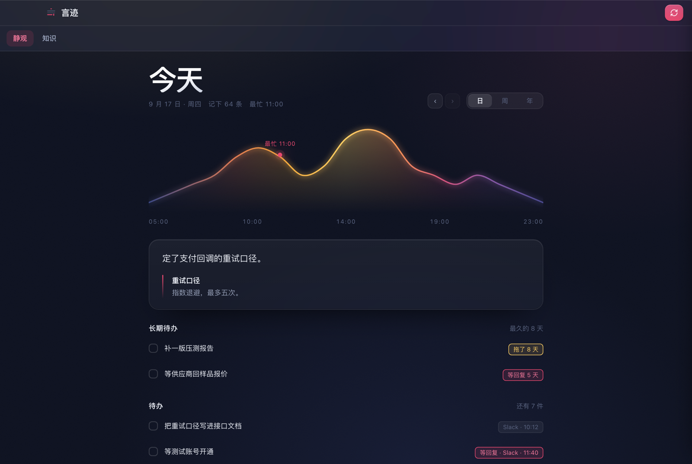
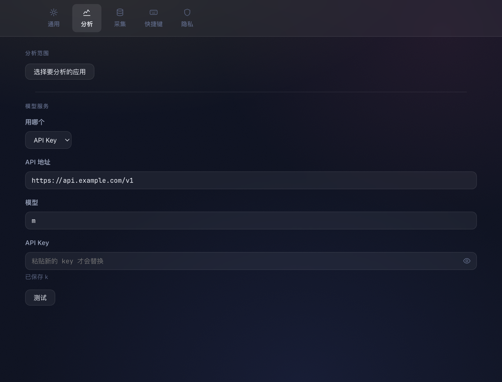

# 言迹 · Telling

> 从你的文字里，看见你

把你每天在电脑上打的字，用 AI 整理成**日报、待办、知识库**的本地 macOS 应用。
文字全部留在你自己的 Mac 上。

**[↓ 下载最新版](https://github.com/dreambe/Telling-releases/releases/latest)**

---

## 不用记

待办不是你输入的，是从你打过的字里长出来的。飞书里说「明天找他确认」，它就在清单里了——你不需要切到另一个 app 去记一遍。

## 分得清谁欠谁

「等回复 5 天」和「拖了 5 天」是两件事。等别人的事不算在你头上——这是大多数待办工具搞混的地方。

## 看得见自己的节奏

一天的曲线、一年的热力图。哪天记得多、几点最忙、连着做了几天，不用自己统计。

## 沉淀下来的判断依据

说过一次就算数的结论、约定、口径，自动收进知识库，可以导出成 Markdown 拿去别处用。

## 抬头就能看

常驻在刘海两侧，鼠标扫过展开最近要做的几件。不用切窗口。

---

## 隐私

这是个读你输入框的应用，所以这一段写在最前面能看见的地方。

- 文字**只存在这台 Mac 上**，加密落盘，密钥在系统钥匙串
- 人名在本地换成代号再出网，**原文不离开本机**
- 发给哪个模型**你自己填**——也可以直接用本机已登录的 Claude Code / Codex，不用另买 key
- 只要一个权限：辅助功能。没有摄像头、没有麦克风、没有通讯录
- 密码管理器、钥匙串这类应用在任何设置下都不采集

## 要什么

- macOS 11 或更新
- Apple Silicon 或 Intel（下载对应的包）
- 一个模型服务：你自己的 API key，或者本机已登录的 Claude Code / Codex

## 装好之后

1. 到「系统设置 → 隐私与安全性 → 辅助功能」里给言迹打勾——不给这个权限它读不到输入框
2. 打开言迹，按引导填上模型服务
3. 照常工作。当天的内容会在你设定的时刻自动整理

设置随时可以用 <kbd>⌘</kbd> <kbd>,</kbd> 打开。

## 更新

应用会自己检查新版本，发现了会提醒你一声。**下载和安装都要你点**——一个在后台读输入框的程序，不该能悄悄把自己换掉。

---

本页截图全部为虚构数据，不含任何真实内容。
