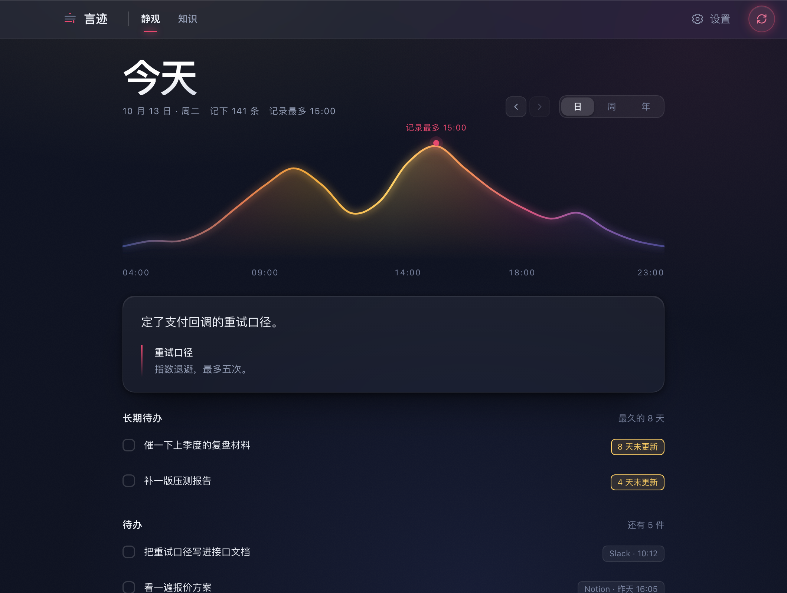
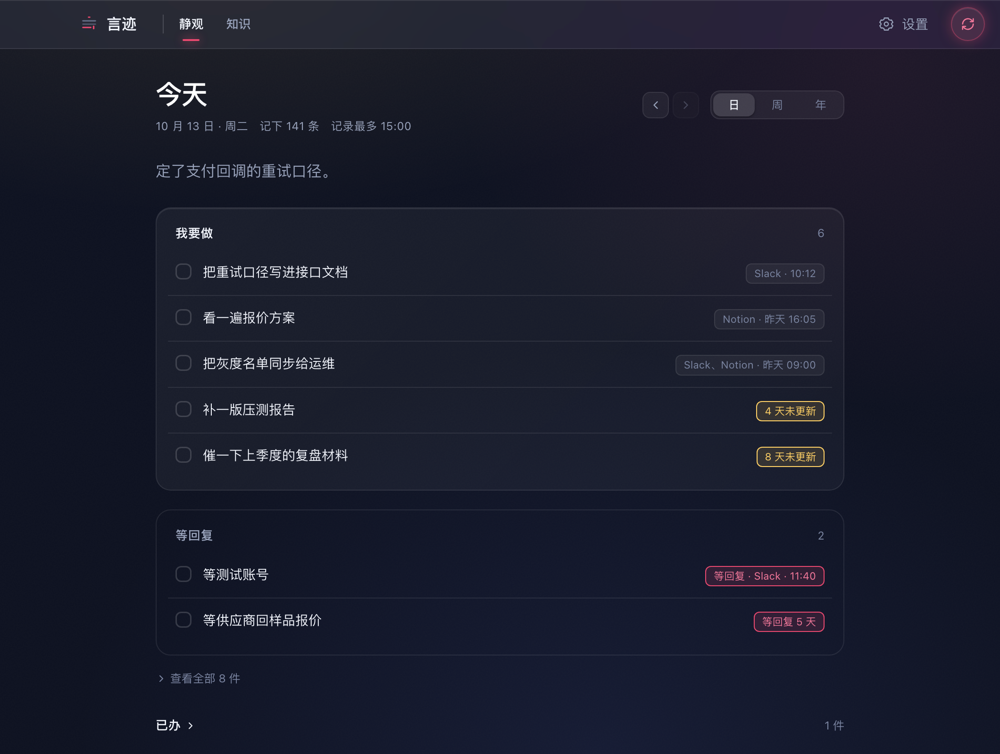
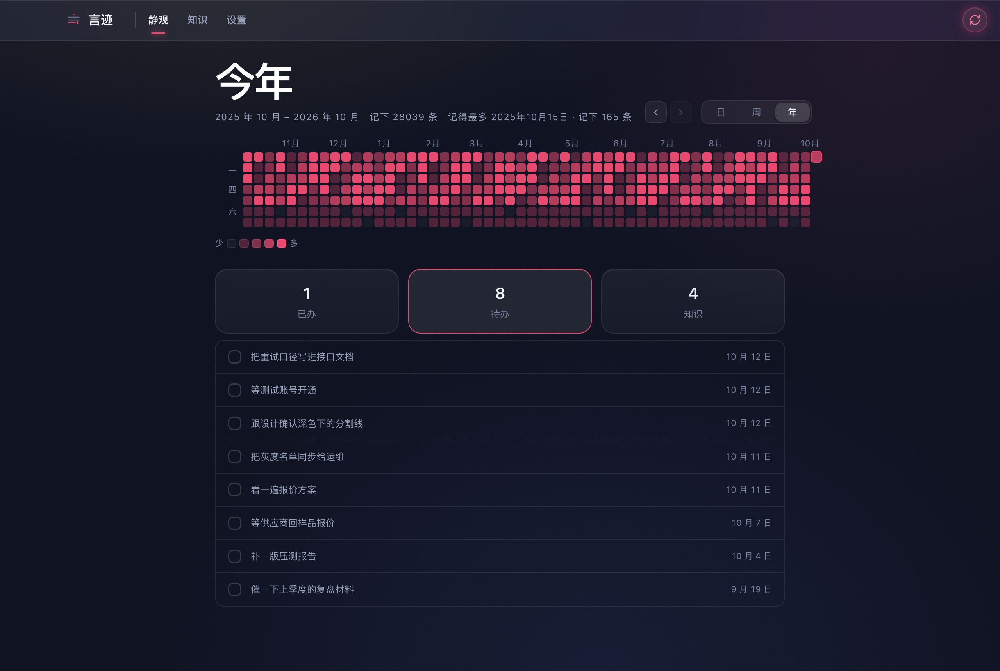
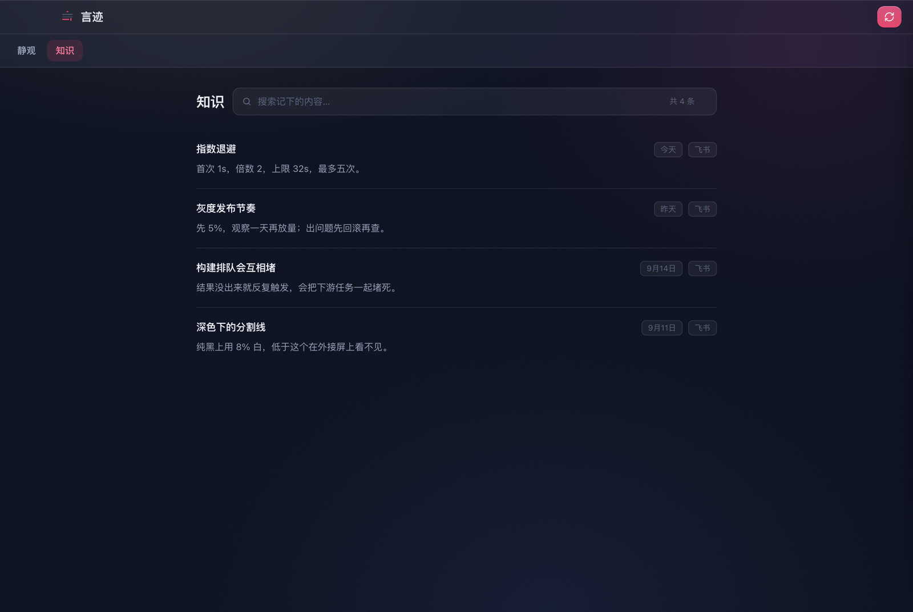
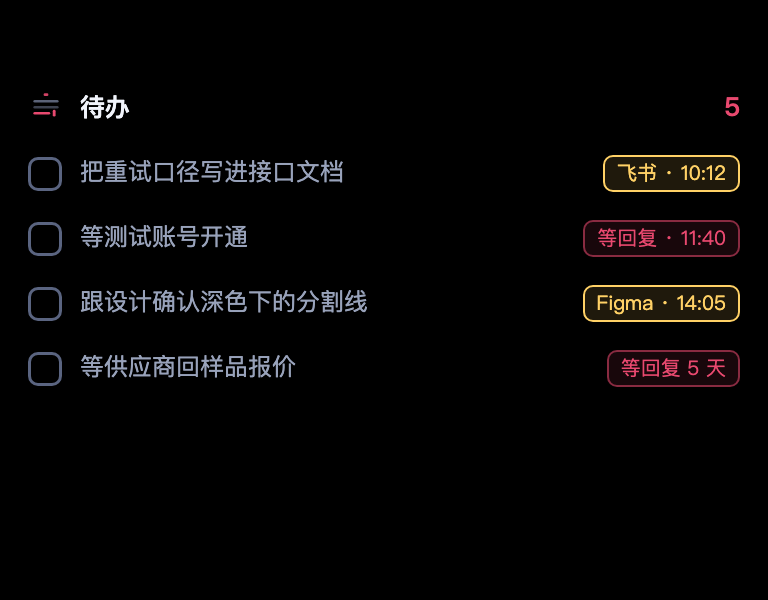

# 言迹 · Telling

**从你说过的话里，找回该做的事。**

把日常输入整理成每日总结、待办和知识库的 macOS 应用。
少记一遍，少漏一件，也更容易看清自己最近在推进什么。

[**下载最新版**](https://github.com/dreambe/Telling-releases/releases/latest) · [安装与开始使用](#安装与开始使用) · [隐私与安全](#隐私与安全)

> 截图全部使用虚构数据，不含真实用户记录。双首页图对应 1.0.6；其余图片展示相应功能。

## 你已经说过，不必再记一遍

飞书里说「明天找设计确认」，讨论中说「等供应商回报价」，复盘时确定了一个新的口径。
这些内容往往散在不同应用里，过几天就很难找全。

言迹在你开启记录后，从允许的应用输入框里记录内容，再用你配置的 AI 模型整理。你可以先看清楚准备发送什么，再确认分析。

| 你想解决的事 | 言迹帮你怎样整理 |
|---|---|
| 今天做了很多，却说不清推进了什么 | 把当天记录整理成总结，提炼重点和进展 |
| 在聊天里答应过的事，后来忘了跟进 | 提取待办，区分自己要做的事和等待别人的回复 |
| 结论、约定和经验散在各处 | 收进知识库，支持搜索、编辑和导出 Markdown |
| 想知道最近的工作节奏 | 用日、周、年视图回看记录分布 |

AI 的判断可能有误。待办和知识可编辑，也可以查看引用的原始记录核对；没有精确引用的旧结果会明确显示为邻近上下文。

## 该做的事，和等别人的事，分开看

「我明天补一版方案」是你的待办；「等对方确认报价」是等待回复。言迹把它们分开，标出多久没有进展，帮你判断下一步该动手，还是该问一句。

完成的事可以勾掉；不合适的条目可以编辑或删除。待办和知识旁的放大镜可以回看本机来源；新记录支持稳定身份和版本，原文变化后会提示结果需要更新。重新分析会保留你的人工修改和完成决定。

## 静观或行动，按你的节奏选择

在「设置 → 通用 → 首页布局」随时切换，两版共用记录和清单，不会产生第二份待办。

| 静观（默认） | 行动 |
|:---:|:---:|
| 保留一天的曲线、玻璃总结和回顾节奏 | 优先看「我要做 / 等回复」，详细回顾和曲线按需展开 |
|  |  |

设置仍在主窗口内。分析时可以反复开关日志，关闭日志不取消任务；加载中的来源面板也能立即关闭。

## 一天的进展，也能留下长期有用的东西

每天的总结帮你回顾进度，知识库保留值得复用的结论和经验。日、周、年视图展示记录节奏，方便回看。

这些曲线反映的是**记录数量与时间分布**，不是对生产力或工作质量的评分。

| 回看这一年 | 找回有用的结论 |
|:---:|:---:|
|  |  |

## 抬头，就能看见下一件事

岛台常驻在屏幕顶部，鼠标移过去就展开最近的待办，可以直接勾选完成。没有刘海的 Mac 也能使用，显示为顶部小胶囊。

你也可以设定每天固定时刻或每隔几小时分析一次。在「设置 → 分析」开启自动分析后按计划发送；手动分析仍会显示发送前检查。应用运行时可在后台工作，不必一直开着主窗口。

分析和到点提醒统一使用 macOS 系统通知，不再额外弹出刘海下方的重复提醒卡片。主动展开的岛台仍保留。

## 下载

当前版本：**1.0.7**。安装包已完成 Developer ID 签名、Apple 公证及票据装订。

本次精简设置和提示文案，改进历史日历与待办操作反馈。分析时，右上角趋势图标沿线显示红色动效；完成提示短暂显示后自动收起。自动分析统一在分析设置页开启，手动分析仍先预览确认。

| 你的 Mac | 下载 |
|---|---|
| Apple Silicon：M1、M2、M3、M4 等 | [下载 Apple Silicon 安装包](https://github.com/dreambe/Telling-releases/releases/download/v1.0.7/Telling-1.0.7-arm64.dmg) |
| Intel 处理器 | [下载 Intel 安装包](https://github.com/dreambe/Telling-releases/releases/download/v1.0.7/Telling-1.0.7-x64.dmg) |

需要 **macOS 12 或更新版本**。不确定芯片类型，可在苹果菜单 →「关于本机」查看。仍使用 macOS 11 的用户请保留兼容的旧版本，不要安装当前版本。

[查看所有版本与更新说明 →](https://github.com/dreambe/Telling-releases/releases)

## 安装与开始使用

1. 打开下载的 DMG，把「言迹」拖进「应用程序」，从那里启动。
2. 在「设置 → 分析」配置模型服务：自己的 API 地址、模型和 Key，或本机已配置好的 Claude Code / Codex CLI。使用 CLI 时，无需在言迹另填 API Key。
3. 在「设置 → 记录」选择记录范围并开启采集，按提示在「系统设置 → 隐私与安全性 → 辅助功能」授权言迹。
4. 照常使用应用，点击右上角分析按钮，检查准备发送的内容，再确认发送。

想定时整理，在「设置 → 分析」开启自动分析并设定时间。模型调用可能产生费用或消耗服务额度，取决于你配置的服务；分析越频繁，调用通常越多。

设置就在主窗口里，也可以按 <kbd>⌘</kbd> + <kbd>,</kbd> 打开。应用发现新版本会提示，下载和安装由你操作。

## 隐私与安全

言迹会读取输入框，因此你应该知道：**它记录了什么、存在哪里、什么时候会发送给谁。**

### 记录和发送，由你分别控制

- **默认不开启采集。** 需要你开启，并授予 macOS 辅助功能权限；对方消息采集也默认关闭。
- **记录范围由你选。** 密码框、搜索框和密码管理器等受保护应用被排除；内容识别仍可能存在边界，敏感工作请主动排除对应应用。
- **手动发送前可以检查。** 预览包含交给模型接口或 CLI 的指令、正文及已有待办等上下文，可以编辑或取消。取消该次请求不会发送其内容；已经确认发出的请求无法撤回。
- **自动分析由你开启。** 在「设置 → 分析」开启后，按计划发送至当前配置的模型服务；关闭后停止后续定时发送。更改模型配置会停止使用旧配置的审核和在途请求。

### 你可以直接核对记录

在「设置 → 记录 → 原始记录」里，你可以按日期、应用和正文搜索，查看完整原文，删除单条或当天记录。**查看原文不会触发 AI 发送。**

在「设置 → 数据与隐私 → 发送记录」里，可以核对请求发起时间、接收方、模型、用途、字数和内容指纹。发送记录不另存一份发送正文；请求已发起也不代表模型处理成功。

### 数据在本机受到哪些保护

原始日志、分析结果、假名映射和发送记录在本机使用 **AES-256-GCM 加密**，密钥与 API Key 由 macOS 钥匙串保管。加密或解密失败会报错，不悄悄降级为明文，也不把无法读取的文件当成空数据覆盖。

正式安装包还使用代码混淆、原生符号剥离和 ASAR 完整性校验，关闭开发调试入口，不包含原生源码和 source map。这些措施提高逆向和篡改成本，不能保证客户端代码不可还原。

安装包包含机器可读的隐私清单。它用于声明数据用途和相关文件元数据访问，不扩大采集权限，也不等于独立隐私认证。

### 哪些内容会离开本机

言迹没有用于收集记录的自有服务器，也没有应用遥测。分析时，内容先在本机脱敏，再发给**你配置的模型服务**；检查更新和下载文件会访问 GitHub。

**本机运行 CLI，不等于本机运行模型。** Claude Code / Codex CLI 的实际服务去向取决于其配置，也可能添加自身上下文。言迹预览的是交给接口或 CLI 的文本；接收服务的数据保留政策仍然适用。

脱敏可能遗漏，不能保证全部敏感信息都被识别。静态加密也无法抵御已经控制你的账户、获准访问钥匙串或运行中内存的攻击者。Apple 公证不是对隐私行为的全面审计。

多机同步可选、默认关闭。开启后，分析结果以可读文件写进你指定的云盘，可能包含真实姓名；原始日志、API Key、假名映射和发送记录不参与同步。请留意云盘共享权限，也留意手动导出文件和屏幕共享。

## 下载前，你可能还想知道

**是不是所有应用都能记录？**
不能保证。覆盖取决于应用和具体编辑器是否提供可读取的辅助功能接口，部分网页和自绘编辑器无法采集。「尚未检测」只表示当前没找到输入框。采不到的内容可以通过「补充记录」主动添加。

**关掉主窗口，记录就停止了吗？**
不会。关闭主窗口只是隐藏，应用仍在后台运行。要停止采集，请关闭「记录」页的采集开关；要停止整个应用，请从菜单或托盘退出。

**适合我吗？**
如果你的工作有大量沟通、协调和复盘，希望从已经输入的内容里整理行动和结论，可以试试言迹。涉及不适合发送给模型的内容时，请限制记录范围，并保留手动发送前检查。

---

[**下载最新版，开始整理你的下一件事 →**](https://github.com/dreambe/Telling-releases/releases/latest)

使用中遇到问题，可以在 [Issues](https://github.com/dreambe/Telling-releases/issues) 反馈。提交截图或日志前，请先移除原文、姓名、联系方式和 Key 等敏感信息。
